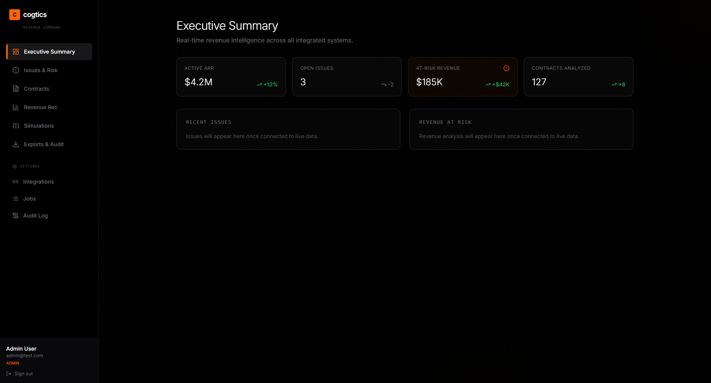
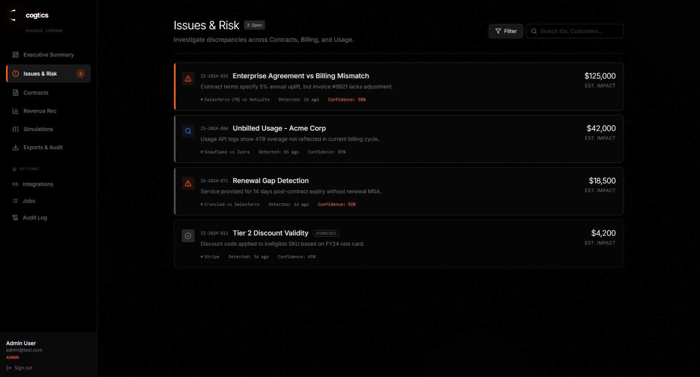
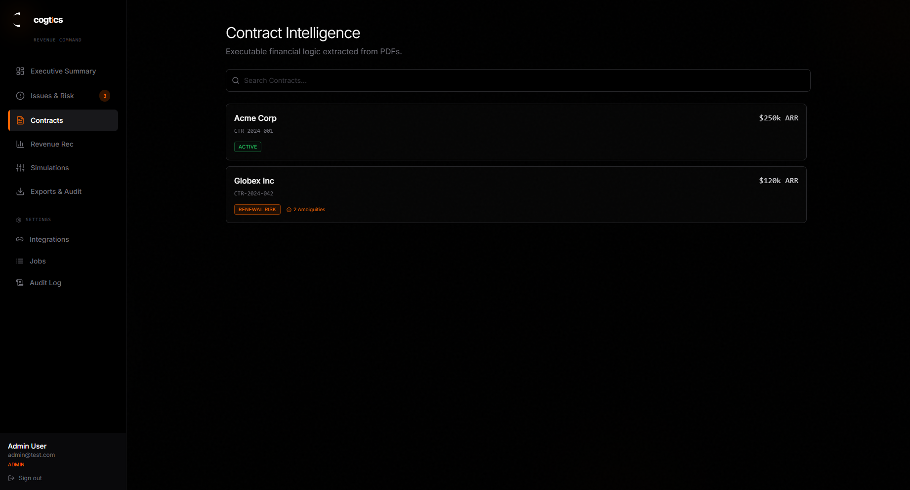
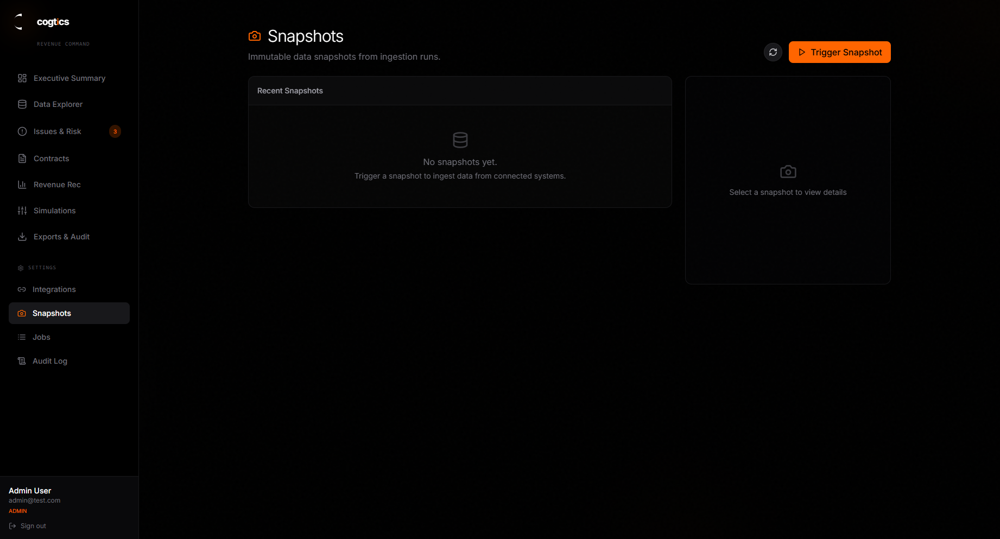

# Cogtics


**Cogtics finds revenue that falls through the cracks between contracts, billing, and CRM.**

A services business records the same customer relationship in several places: a signed contract, an invoice in the accounting system, and a deal in the CRM. When those records disagree — or when one goes missing — money quietly leaks out. Cogtics pulls those records together, compares them, and shows where the story does not add up.

## What Cogtics does — in plain English

Cogtics connects the tools a business already uses, or accepts exported files when there is no integration. It then asks three questions:

- **Did we sell what we think we sold?** It reads contracts and checks the commercial terms: what was promised, for how long, and at what price.
- **Did we bill what we sold?** It compares contracts against invoices and flags missing, under-, or over-billing.
- **Did we collect what we billed?** It looks at payments, aging, and revenue schedules to find money that is late or not yet recognized.

The answers become **issues** with a severity, a source trail, and a suggested next step. The team can review them in a dashboard, export an audit-ready report, or test a pricing change in a simulation before applying it.

A simple example:

> A contract says a customer pays $5,000 per month. The CRM says the deal is active. QuickBooks shows no invoice for the last two months. Cogtics flags the missing billing, links it back to the contract and the CRM record, and puts it on the dashboard as a high-severity issue.

## How it works — in plain English

1. **Connect the sources.** Link Stripe, Salesforce, HubSpot, QuickBooks, DocuSign, or upload a CSV/PDF export.
2. **Put everything in one shape.** A four-stage ingestion pipeline loads the raw data, normalizes provider-specific formats, upserts it into a canonical model, and finalizes a snapshot.
3. **Match the same customer.** Identity resolution merges customer records that appear under different IDs in different systems, with a review queue for ambiguous matches.
4. **Look for leaks.** A detection engine runs 62 rules across billing, contracts, revenue recognition, data quality, and related categories.
5. **Explain every finding.** Each issue can carry an evidence pack with source records, calculation steps, and contract clause excerpts.
6. **Let the team act.** Review issues in the web app, generate exports and digests, or simulate pricing and timing changes against a snapshot before changing production data.

| Dashboard | Issues |
|---|---|
|  |  |

| Contracts | Snapshots |
|---|---|
|  |  |

---

## Capabilities in detail

- **Connects external systems** — Stripe, Salesforce, HubSpot, QuickBooks, and DocuSign connectors with OAuth, incremental sync, and encrypted credential storage.
- **Builds a canonical model** — a four-stage ingestion pipeline (load → normalize → upsert → finalize) turns provider-specific payloads into consistent customers, contracts, invoices, payments, and usage records.
- **Resolves customer identity** — blocking, scoring, and threshold-based matching merge fragmented customer records across systems, with a review queue for ambiguous matches.
- **Runs detection** — 62 rules across 11 categories (billing, discounts, revenue recognition, contract lifecycle, data quality, credits, tax/fees, FX, usage, multi-entity, cross-snapshot).
- **Extracts contract intelligence** — PDF text extraction, clause segmentation, structured term extraction, confidence scores, readiness checks, and an override workflow.
- **Recognizes revenue** — ASC 606 performance obligations, transaction-price allocation, revenue schedules, and reconciliation against billing.
- **Generates evidence** — immutable, snapshot-scoped evidence packs that link issues to source records, calculations, and contract clauses.
- **Runs simulations** — apply parameter overrides to a snapshot and compare revenue and recognition deltas without changing source records.
- **Exports and digests** — CSV exports, PDF audit bundles, and scheduled email summaries.
- **Operates it** — job queue, dead-letter queue, audit log, health checks, metrics, traces, and Grafana dashboards.

---

## Architecture

```
┌─────────────────┐      ┌─────────────────┐      ┌──────────────┐
│   React SPA     │─────▶│   Fastify API   │─────▶│  PostgreSQL  │
│   (apps/web)    │      │   (apps/api)    │      │  (Kysely)    │
└─────────────────┘      └────────┬────────┘      └──────────────┘
                                  │
                                  ▼
                         ┌─────────────────┐      ┌──────────────┐
                         │  Redis/BullMQ   │─────▶│    Worker    │
                         │   Job Queue     │      │ (apps/worker)│
                         └─────────────────┘      └──────┬───────┘
                                                          │
                                                          ▼
                                                 ┌─────────────────┐
                                                 │  MinIO / S3     │
                                                 │  Raw + exports  │
                                                 └─────────────────┘

                 OpenTelemetry → Collector → Prometheus / Loki / Tempo → Grafana
```

### Request and job flow

1. The React app talks to the Fastify API.
2. The API authenticates the user, resolves the tenant, applies RBAC, and sets the PostgreSQL tenant context.
3. Long-running work is written to the `jobs` table and pushed to BullMQ.
4. Workers pick up jobs (ingest, detect, extract, simulate, export, digest) and write results back.
5. Every mutation is audit-logged; every job validates its payload with Zod.

### Tenant isolation

Tenant isolation is enforced at three levels:

- **Application** — every request is scoped to a tenant and validated against the user's membership.
- **Database** — PostgreSQL Row Level Security policies use `current_setting('app.tenant_id')`.
- **Storage** — S3 objects are keyed under `tenants/{tenant_id}/...`.

---

## Monorepo layout

```
apps/
├── api/           Fastify API: auth, RBAC, routes, plugins, webhooks
├── web/           React + Vite SPA: dashboard, issues, contracts, rev rec, simulations, admin
└── worker/        BullMQ processors: ingestion, detection, contracts, rev rec, exports, digests

packages/
├── connectors/    Stripe, Salesforce, HubSpot, QuickBooks, DocuSign
├── db/            Kysely client, migrations, seeds
├── revrec/        ASC 606 revenue recognition engine
├── rules/         Detection rule catalog and evaluators
├── schemas/       Zod schemas and branded ID types
└── utils/         Config, S3, logging, shared helpers

docker/            Postgres, Redis, MinIO, pgAdmin, OTel, Prometheus, Loki, Tempo, Grafana
e2e/               Playwright end-to-end tests
tools/             Synthetic data generation and validation utilities
docs/              Architecture, phase plans, runbooks, feature specs
```

---

## Tech stack

| Layer | Technology |
|---|---|
| Frontend | React 18, Vite, TypeScript, React Router, TanStack Query, Tailwind, Framer Motion, Clerk |
| API | Fastify, TypeScript, Zod, Pino, JOSE, Clerk backend |
| Jobs | Redis, BullMQ, worker processes, dead-letter queue |
| Database | PostgreSQL 16, Kysely, dbmate migrations, Row Level Security |
| Storage | S3-compatible MinIO |
| Connectors | Stripe, Salesforce (jsforce), HubSpot, QuickBooks, DocuSign |
| Observability | OpenTelemetry, Prometheus, Loki, Tempo, Grafana |
| Testing | Vitest, Testing Library, MSW, Playwright |
| Local infra | Docker Compose |

---

## Quick start

### Prerequisites

- Node.js 20+
- pnpm 8+ (`corepack enable` or `npm install -g pnpm`)
- Docker and Docker Compose
- dbmate (`brew install dbmate` on macOS)

### Run it

```bash
git clone https://github.com/bhoopesh-cmd/cogtics.git
cd cogtics

cp env.example .env
pnpm install
pnpm docker:up
pnpm db:migrate
pnpm db:seed

# API + web
pnpm dev

# In another terminal: background worker
pnpm dev:worker
```

- Web: http://localhost:5173
- API: http://localhost:3000
- MinIO console: http://localhost:9001
- pgAdmin: http://localhost:5050
- Grafana: http://localhost:3002

### Test users (after `pnpm db:seed`)

| Role | User ID | Email |
|---|---|---|
| Admin | `user_01` | admin@test.com |
| CFO | `user_02` | cfo@test.com |
| Analyst | `user_03` | analyst@test.com |

Tenant: `tenant_01`. In dev mode the API uses header-based auth:

```bash
curl http://localhost:3000/me \
  -H "x-tenant-id: tenant_01" \
  -H "x-user-id: user_01"
```

---

## Common commands

```bash
pnpm dev            # Docker infra + API + web
pnpm dev:worker     # background worker
pnpm build          # build web and API
pnpm lint           # ESLint
pnpm typecheck      # TypeScript across the workspace
pnpm test:unit      # unit + component tests (what CI runs)
pnpm test           # full suite, including API integration/smoke tests
pnpm test:e2e       # Playwright
pnpm validate:all   # validation, detection, tenant, resilience, security suites
pnpm db:migrate     # apply migrations
pnpm db:seed        # seed roles, permissions, and test data
```

See [`docs/local-dev.md`](docs/local-dev.md) for the full setup and troubleshooting guide.

---

## Testing

- **Unit and integration** — Vitest across packages and apps.
- **API** — smoke, integration, and security suites under `apps/api/tests`. These expect the Docker stack and a running API; run them after `pnpm docker:up`, `pnpm db:migrate`, and `pnpm dev`.
- **Frontend** — Testing Library + MSW under `apps/web/src/test`.
- **End-to-end** — Playwright flows under `e2e/`.
- **Validation** — `tools/validation` covers detection, tenant isolation, resilience, and security.

CI runs `pnpm test:unit` on every push and pull request. Current results and known gaps are tracked in [`docs/TESTING_STATUS.md`](docs/TESTING_STATUS.md).

---

## Documentation

- [Architecture](docs/architecture.md)
- [Local development](docs/local-dev.md)
- [Canonical data model](docs/canonical-model.md)
- [Connector framework](docs/connectors.md)
- [Ingestion pipeline](docs/ingestion.md)
- [Identity resolution](docs/identity-resolution.md)
- [Detection rules](docs/detection-rules.md)
- [Contract intelligence](docs/contract-intelligence.md)
- [Revenue recognition](docs/revenue-recognition.md)
- [Evidence packs](docs/evidence-packs.md)
- [Simulations](docs/simulations.md)
- [Exports and digests](docs/exports.md)
- [Observability](docs/observability.md)
- [Runbooks](docs/runbooks.md)

---

## Notes

- **Dataset:** the CUAD contract corpus is not committed. The synthetic-data tooling downloads it from Hugging Face on first use.
- **Secrets:** `.env` is ignored. `env.example` contains placeholders only; never commit real credentials.
- **Status:** this is an actively developed MVP covering phases 0–11. It is not a production-hardened release; see `docs/TESTING_STATUS.md` before relying on any surface.
- **History:** this is the full-stack rewrite of an earlier Streamlit prototype, which lives in a separate private repository.
